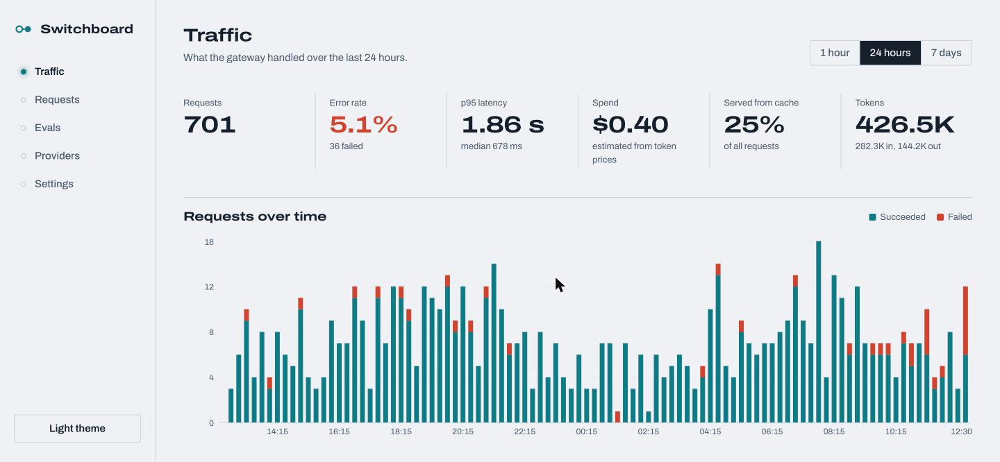
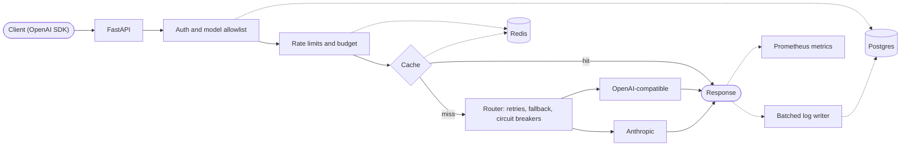
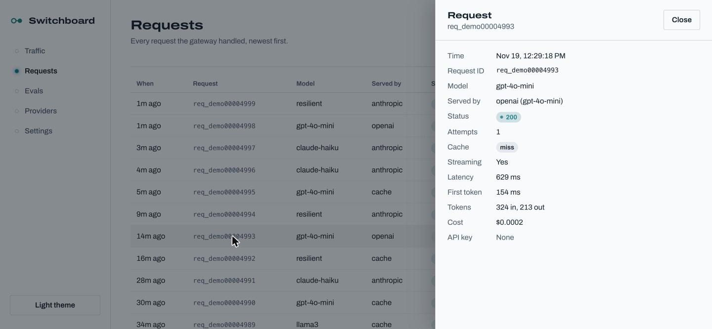
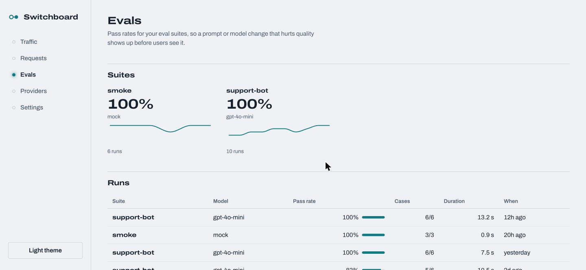

# Switchboard

[](https://github.com/Yaksh88/switchboard/actions/workflows/ci.yml)
[](LICENSE)


A self-hosted gateway that puts one OpenAI-compatible API in front of every model provider. It
routes and fails over between providers, caches answers, enforces per-key rate limits and
budgets, tracks cost and latency, and ships an eval harness that fails your build when a prompt
or model change makes answers worse.

Point any OpenAI SDK at it by changing `base_url`. Nothing else in your application changes.



## What it does

- **One API, many providers.** OpenAI-compatible `/v1/chat/completions` (including streaming) in
  front of OpenAI, Anthropic, and any OpenAI-compatible server such as vLLM or Ollama.
- **Routing with fallback.** Each model alias is an ordered list of targets. Retryable failures
  are retried with exponential backoff, then fail over to the next target. Per-target circuit
  breakers stop sending traffic to a model that keeps failing.
- **Caching.** An exact-match cache in Redis, plus an optional semantic cache that matches
  near-duplicate prompts by embedding similarity.
- **Keys, limits and budgets.** Virtual API keys with model allowlists, requests-per-minute and
  tokens-per-minute limits (atomic Redis token buckets), and monthly spend budgets.
- **Cost and observability.** Per-request cost from token prices, a request log in Postgres,
  Prometheus metrics, JSON access logs, and a dashboard.
- **Evals as regression tests.** YAML suites with eight assertion types (including LLM-as-judge)
  run against the gateway; the CLI exits non-zero on a regression, so CI can gate on it.

## Quickstart

### With Docker Compose

```bash
git clone https://github.com/Yaksh88/switchboard.git && cd switchboard
cp .env.example .env          # set SWITCHBOARD_ADMIN_TOKEN, e.g. with: openssl rand -hex 32
docker compose -f deploy/docker-compose.yml up --build
```

This starts the gateway, Postgres and Redis, applies the migrations, and serves the dashboard at
<http://localhost:8080/dashboard/> (paste your admin token under Settings). Create an API key:

```bash
docker compose -f deploy/docker-compose.yml exec gateway \
  switchboard keys create --name demo --rpm 60
```

Add `--profile observability` to also run Prometheus (port 9090) and Grafana (port 3000) with a
provisioned Switchboard dashboard.

### Locally, with no dependencies

The built-in `mock` provider needs no API keys, Postgres or Redis:

```bash
uv sync
SWITCHBOARD_CONFIG_PATH=config/ci.yaml SWITCHBOARD_AUTH_ENABLED=false \
SWITCHBOARD_DATABASE_URL= uv run switchboard serve
```

```bash
curl localhost:8080/v1/chat/completions \
  -H 'content-type: application/json' \
  -d '{"model": "mock", "messages": [{"role": "user", "content": "Hello!"}]}'
```

For real providers, copy `config/switchboard.example.yaml` to `config/switchboard.yaml`, export
`OPENAI_API_KEY` and `ANTHROPIC_API_KEY`, and run Postgres and Redis (the Compose file's
`postgres` and `redis` services work: `docker compose -f deploy/docker-compose.yml up postgres redis`).

## Using it

Use the official OpenAI SDK; only the base URL and key change:

```python
from openai import OpenAI

client = OpenAI(base_url="http://localhost:8080/v1", api_key="sb-your-switchboard-key")

reply = client.chat.completions.create(
    model="resilient",  # an alias from your gateway config
    messages=[{"role": "user", "content": "Hello!"}],
)
print(reply.choices[0].message.content)
```

Every response carries headers describing what the gateway did:

| Header | Meaning |
| --- | --- |
| `x-request-id` | Id to find the request in the dashboard and logs |
| `x-switchboard-provider` | Which provider answered, or `cache` |
| `x-switchboard-cache` | `miss`, `exact`, `semantic` or `bypass` |
| `x-switchboard-attempts` | Upstream calls made, including retries and fallbacks |
| `x-switchboard-cost-usd` | Estimated cost of this request |
| `x-ratelimit-remaining-requests` | Requests left in the key's per-minute bucket |

Streamed responses carry only `x-request-id`, because headers are sent before the first token.
Send `x-switchboard-cache: bypass` on a request to skip the cache.

## Configuration

Models, providers, prices and cache settings live in one YAML file; secrets stay in the
environment.

```yaml
providers:
  openai:    { type: openai,    api_key: ${OPENAI_API_KEY} }
  anthropic: { type: anthropic, api_key: ${ANTHROPIC_API_KEY}, max_retries: 2 }

cache:
  enabled: true
  semantic: { enabled: true, threshold: 0.92 }

models:
  # Clients ask for "resilient"; the gateway tries Anthropic first, then OpenAI.
  resilient:
    targets:
      - { provider: anthropic, model: claude-haiku-4-5, input_cost_per_mtok: 1.00, output_cost_per_mtok: 5.00 }
      - { provider: openai,    model: gpt-4o-mini,      input_cost_per_mtok: 0.15, output_cost_per_mtok: 0.60 }
```

See [docs/configuration.md](docs/configuration.md) for every option, endpoint and CLI command.

## Architecture



A request is authenticated, checked against the key's limits, looked up in the cache, and only
then routed to a provider. Accounting happens off the request path: log rows go to a bounded
queue and a background task batches them into Postgres. If Redis or the log queue is unavailable,
requests are still served. [docs/architecture.md](docs/architecture.md) walks through the
lifecycle, and [docs/design-decisions.md](docs/design-decisions.md) records the trade-offs.

## Evals in CI

```yaml
- name: Start the gateway
  run: uv run switchboard serve &
- name: Run evals
  run: >-
    uv run switchboard eval run evals/support-bot.yaml
    --baseline baselines/ --max-regression 0.05
    --summary-md "$GITHUB_STEP_SUMMARY"
```

The step fails if a critical case fails or the pass rate drops more than five points below the
stored baseline. See [docs/evals.md](docs/evals.md) and [examples/evals](examples/evals).

## Dashboard

| Requests | Evals |
| --- | --- |
|  |  |

The **Providers** page shows each upstream model as a jack on a patch panel, lit while its circuit
breaker is closed. The dashboard is built into the Docker image and served at `/dashboard/`.

## Performance

The gateway adds well under a millisecond of its own time to an uncached request, and a few
thousand requests per second per machine, measured against a zero-latency mock provider on an
8 GB Apple M1 laptop with the load generator on the same machine:

| Scenario | Requests/s | In-gateway p50 | p95 | p99 |
| --- | ---: | ---: | ---: | ---: |
| uncached | 9,760 | <0.1 ms | 0.1 ms | 0.2 ms |
| cached (Redis) | 6,384 | 0.8 ms | 6.2 ms | 24.7 ms |

Results varied by about 40% between runs on that machine. Methodology, caveats and what the
benchmark leaves out are in [benchmarks/README.md](benchmarks/README.md).

## Development

```bash
make install        # Python and dashboard dependencies
make test           # needs Postgres and Redis; integration tests skip if they're down
make lint           # ruff, mypy --strict, dashboard lint and typecheck
make dev            # gateway with auth off
make seed           # fill a dev database with a week of demo traffic
```

Integration tests use the `switchboard_test` database and Redis database 15; point them
elsewhere with `SWITCHBOARD_TEST_DATABASE_URL` and `SWITCHBOARD_TEST_REDIS_URL`. See
[CONTRIBUTING.md](CONTRIBUTING.md) for the branching model and commit style.

```
src/switchboard/
  api/            FastAPI app and routes (chat, admin, stats)
  providers/      OpenAI, Anthropic and mock adapters
  routing/        router and circuit breaker
  cache/          exact and semantic caches, embedders
  auth/           API keys, budgets
  ratelimit/      Redis token bucket (Lua)
  observability/  cost, metrics, request log writer
  evals/          suites, scorers, runner, reports
dashboard/        React admin app
migrations/       Alembic migrations
deploy/           Docker Compose, Prometheus, Grafana
```

## Limitations and roadmap

- The Anthropic adapter translates text chat only; tool calls and images aren't translated yet
  (the OpenAI adapter passes extra request fields through unchanged).
- Circuit breaker state is per process. With several gateway replicas each learns about a failing
  provider on its own; sharing it through Redis is planned.
- Planned: tool-call translation, an embeddings endpoint, OpenTelemetry traces.

## License

[MIT](LICENSE)
